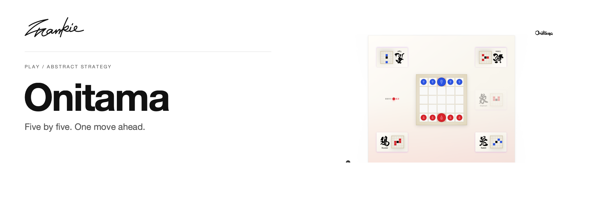

# Frankie Onitama

[English](README.md) · [简体中文](README.zh-CN.md)

A five-by-five board, a handful of movement cards, and one move to think through.

[Introduction](https://songhaifan.github.io/frankie-onitama/) · [Guide](docs/guide.md) · [Run locally](#run-locally)

## What it does

- Move pieces using the current movement cards and exchange the card you play.
- Choose card packs, including variants with Wind Spirit mechanics.
- Use the board with pointer or touch controls, with optional audio.

## Run locally

```sh
npm ci
npm run dev
```

Open the local URL printed by Next.js.

## Before you start

The selected card pack determines the available movement rules. See the [architecture notes](ARCHITECTURE.md) for game state, card exchange and variant mechanics.

## For developers

```sh
npm run build
```

Check move legality, card exchange, winning conditions and touch input in local play.

[Project guide](docs/guide.md) · [Artwork](docs/readme/README.md)

---

Made by [Songhai Fan](https://github.com/SonghaiFan) · A Frankie project
