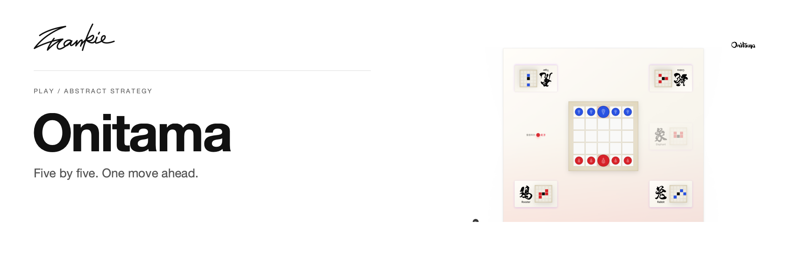

# Frankie Onitama

[English](README.md) · [简体中文](README.zh-CN.md)

一块五乘五的棋盘，几张移动卡，以及值得想清楚的下一步。

[介绍页](https://songhaifan.github.io/frankie-onitama/zh/) · [项目指南](docs/guide.md) · [本地运行](#本地运行)

## 可以做什么

- 按当前移动卡走棋，并交换刚使用的卡牌。
- 选择卡包，包括带有风灵机制的变体。
- 使用鼠标或触控操作棋盘，可选开启音效。

## 本地运行

```sh
npm ci
npm run dev
```

打开 Next.js 输出的本地地址。

## 开始之前

所选卡包决定可用的移动规则。游戏状态、卡牌交换与变体机制见[架构说明](ARCHITECTURE.md)。

## 开发说明

```sh
npm run build
```

在本地对局中检查走棋合法性、卡牌交换、胜利条件与触控输入。

[项目指南](docs/guide.md) · [Banner 维护](docs/readme/README.md)

---

由 [Songhai Fan](https://github.com/SonghaiFan) 制作 · Frankie 系列项目
